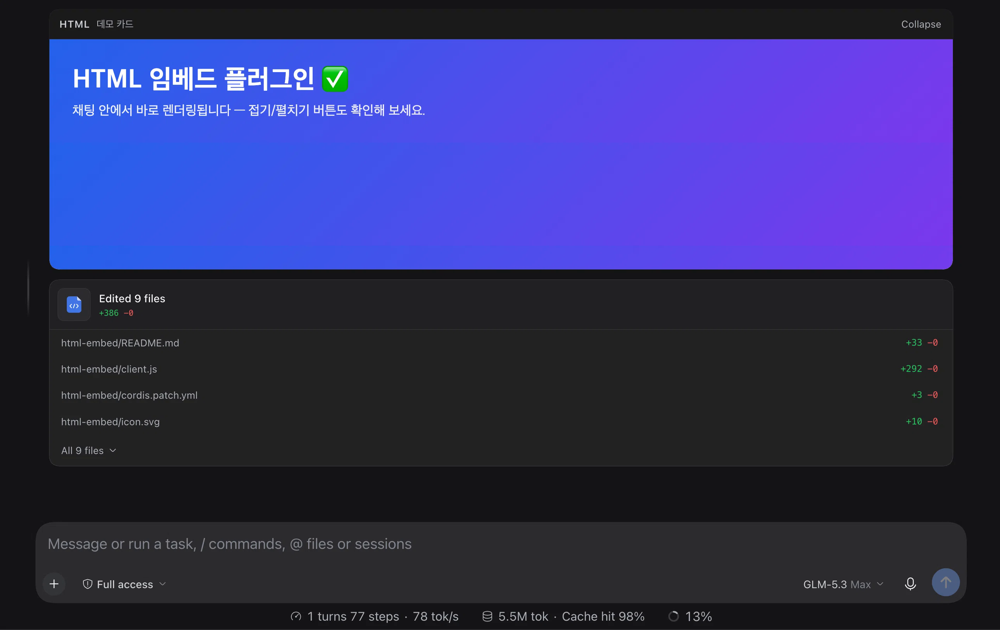

# HTML Embed

[](https://github.com/pinion05/dsh-html-embed)
[](./LICENSE)
[](#security)

Render fenced HTML code blocks from assistant messages as **live, sandboxed previews — directly inside the chat**. No tabs, no side panel: the runnable result appears right under the message that produced it, while the original code block stays untouched.



## Why

Chat UIs escape-code HTML into a wall of `&lt;div&gt;`. When an agent answers with an HTML snippet — a card, a chart mockup, a styled email template — you copy it into a file, open a browser, and refresh on every iteration. This plugin collapses that loop: the assistant's HTML *is* the preview.

## Features

- **Automatic** — every finalized assistant message with a fenced ` ```html ` / ` ```htm ` block gets preview cards directly beneath it; nothing to click
- **Sandboxed by default** — frames render with `sandbox=""`: scripts blocked, opaque origin, no access to the app's DOM, storage, or session data
- **Multi-block** — several HTML blocks in one message become separate cards (up to `maxBlocks`)
- **Collapsible cards** — per-card collapse/expand, remembered across list virtualization
- **Card titles** — ` ```html title="Dashboard" ` (or any trailing info-string text) is shown in the card header
- **Theme-aware chrome** — header and controls use the host's `--dsw-alias-*` design tokens; the frame content stays yours
- **Localized UI** — English, 한국어, 中文

## Usage

Ask your agent for HTML, e.g. *"Show me a ```html demo card with a gradient banner"*. Any fenced block whose info string starts with `html`/`htm` renders under the reply:

````
```html title="Demo"
<h1 style="color: royalblue">It just works.</h1>
```
````

## Configuration

Set a page-level override **before** the app loads (read once at activation) — e.g. from a userscript or the browser console on a fresh reload:

```js
window.__DSH_HTML_EMBED_CONFIG__ = {
  langs: ["html", "htm"], // fence info-string languages that render a preview
  maxBlocks: 4,           // max preview cards per message (1–20)
  height: 280,            // iframe height in px (80–2000)
  allowScripts: false,    // render with sandbox="allow-scripts" instead of sandbox=""
  collapsed: false        // start every card collapsed
};
```

| Option | Type | Default | Description |
|---|---|---|---|
| `langs` | `string[]` | `["html", "htm"]` | Fence info-string languages that trigger a preview (case-insensitive, leading `.` ignored) |
| `maxBlocks` | `number` | `4` | Maximum preview cards rendered per assistant message |
| `height` | `number` | `280` | Card frame height in pixels |
| `allowScripts` | `boolean` | `false` | Allow scripts inside the sandboxed frame — see [Security](#security) |
| `collapsed` | `boolean` | `false` | Render cards collapsed until expanded |

## How it works

Pure client-side Cordis plugin — roughly 300 lines, no Host logic:

1. **Event definition** (`uiConversation.events.register`) — a `html-preview` definition folds finalized `assistant/message` events, extracts fenced HTML blocks from the text content, and publishes a Chat node anchored a fraction of a sequence number after the closing assistant message, so ordering stays stable across reloads, forks, and replay.
2. **Renderer** (`conversation.chat.node` keyed slot) — draws each extracted block as a sandboxed `<iframe srcdoc>` card with a themed header.
3. **No session writes** — the plugin adds no new session events; everything derives from the existing log, so it is safe to uninstall at any time (past messages simply lose their cards).

## Security

The frame uses the same isolation model as DSH's built-in Sidebar document preview:

- Default `sandbox=""` — **scripts are blocked** and the frame runs on an opaque origin. Embedded HTML cannot reach the app's DOM, `localStorage`, cookies, session data, or host callbacks; nothing from inside the frame can enter the parent page.
- `allowScripts: true` still keeps the opaque origin and parent isolation — only the script-execution gate opens. Enable it only for content you trust.
- Guardrails: bodies over 200 KB are truncated (announced in the card header), and at most `maxBlocks` cards render per message.

## Limitations

- Scripts are disabled by default, so JS-driven demos render as static markup.
- External CDN assets (stylesheets, fonts, images) may be restricted by browser rules for sandboxed documents and the app's CSP; inline markup and styles render reliably.
- Frame height is fixed per configuration — a sandboxed frame cannot auto-report its size.

## Compatibility

Built and verified against the DSH Web GUI client module loader and Cordis slot system (November 2026). The plugin uses documented extension points (`uiConversation.events.register` and the `conversation.chat.node` keyed slot); minor DSH updates may require small adjustments.

## License

[MIT](./LICENSE) © pinion05
